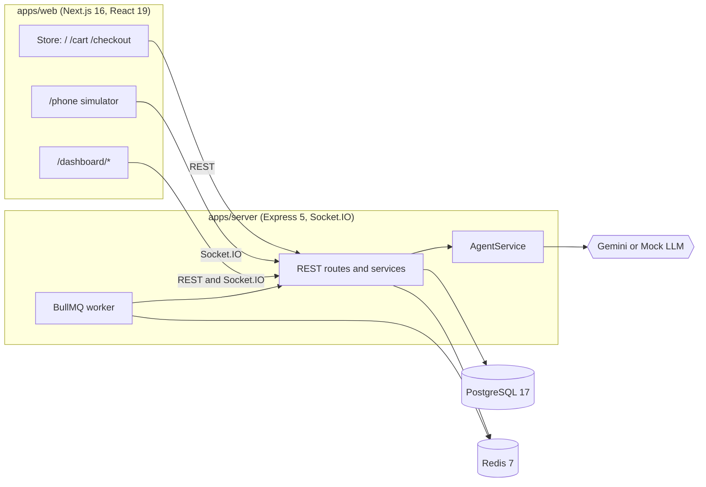

# VoiceRetain AI

An AI voice agent that recovers abandoned e-commerce checkouts. When a shopper starts checkout and leaves, the system rings them (in a browser "phone"), an AI agent talks to them, can offer a **server-capped** discount code, and the merchant watches the whole thing live on a dashboard.

Built as a college demo. Everything runs locally; there is no real telephony or payment. Full requirements: [docs/PRD.md](docs/PRD.md).

| Doc | What it is |
|---|---|
| [docs/architecture.md](docs/architecture.md) | Flow, state machine, data model, guardrail, queue and cache design |
| [docs/demo-guide.md](docs/demo-guide.md) | Pre-demo checklist, the script, what to do if something fails |
| [docs/viva-notes.md](docs/viva-notes.md) | Short answers to likely examiner questions |
| [docs/acceptance-checklist.md](docs/acceptance-checklist.md) | Every requirement with an honest verified / unverified status |

## How it works

1. A shopper fills checkout on **ShopNest** (the demo store), consents to a call, and leaves.
2. A delayed BullMQ job fires. If the cart is still unpaid, the call rings on the **Phone** page.
3. The shopper answers and talks (voice or typed). The agent, backed by Gemini, handles objections and may issue a discount code.
4. The server, not the model, enforces the discount rules (tiers 5/10/15 %, hard cap 15 %).
5. The **Dashboard** updates live over Socket.IO: calls, transcripts, sentiment, vouchers, revenue recovered.

## Architecture



## Tech stack

- **Web:** Next.js 16, React 19, Tailwind v4, Framer Motion, Recharts, Web Speech API
- **Server:** Node.js, Express 5, Socket.IO 4, BullMQ, Zod, Pino
- **Data:** PostgreSQL 17 via Prisma 7 (`adapter-pg`), Redis 7
- **AI:** Google Gemini (`@google/genai`), with a deterministic `MockLlmClient` for offline demos and tests
- **Tests:** Vitest, React Testing Library, Supertest
- **Shared package:** `@voiceretain/shared` with money, phone and voucher utilities, schemas and event types

## Quick start

Needs Node 22 or newer, PostgreSQL 17 and Redis 7.

```bash
cp .env.example .env
npm install
```

Start Postgres and Redis. Either way works:

- **Docker:** `docker compose up -d postgres redis`
- **Local installs:** create the database and user with [scripts/local-db-setup.sql](scripts/local-db-setup.sql) and start Redis.

Then:

```bash
npm run db:migrate
npm run db:seed
npm run dev
```

Open the store at <http://localhost:3000>, the phone at <http://localhost:3000/phone> and the dashboard at <http://localhost:3000/dashboard>. The API is on <http://localhost:4000>.

For the AI, either set `MOCK_LLM=true` (no key needed) or set `GEMINI_API_KEY` and `MOCK_LLM=false` in `.env`. Never commit `.env`; it is git-ignored.

`db:seed` loads the product catalogue (see below) and 20 historical calls, so the dashboard has data from the first minute.

### Product catalogue

Products are fetched from <https://dummyjson.com/products>, converted from USD to INR (`CATALOGUE_USD_TO_INR`, default 85), with vehicles excluded. If the fetch fails, the 6 built-in products are used instead. Products that disappear from the source are retired, not deleted, so old orders stay intact.

## Configuration

All variables live in `.env` (see [.env.example](.env.example)).

| Variable | Default | Meaning |
|---|---|---|
| `PORT` | 4000 | Server port |
| `WEB_ORIGIN` | http://localhost:3000 | Allowed CORS origin |
| `DATABASE_URL` | local Postgres | Main database |
| `DATABASE_URL_TEST` | local Postgres | Database used by the server tests |
| `REDIS_URL` | redis://localhost:6379 | Queue, caches, runtime config |
| `GEMINI_API_KEY` | empty | Required when `MOCK_LLM=false` |
| `GEMINI_MODEL` | gemini-3.8-flash | Model name |
| `MOCK_LLM` | false | Use the deterministic mock instead of Gemini |
| `LLM_TIMEOUT_MS` | 8000 | Per-request model timeout |
| `ABANDON_DELAY_MS` | 30000 | Wait before an unpaid checkout counts as abandoned |
| `RING_TIMEOUT_MS` | 30000 | Unanswered call becomes missed |
| `MAX_CALL_DURATION_MS` | 300000 | Hard limit on call length |
| `DISCONNECT_GRACE_MS` | 15000 | Wait for a dropped phone to reconnect |
| `MAX_DISCOUNT_PERCENT` | 15 | Discount cap. Can be lowered, never raised above 15 |
| `MIN_CART_FOR_DISCOUNT_PAISE` | 50000 | Carts under ₹500 get no discount |
| `VOUCHER_TTL_HOURS` | 24 | Code lifetime |
| `DEMO_MODE` | true | Enables the demo control routes |
| `CATALOGUE_URL` | dummyjson products | Product source |
| `CATALOGUE_USD_TO_INR` | 85 | Conversion rate |
| `NEXT_PUBLIC_API_URL` | http://localhost:4000 | API base used by the browser |
| `NEXT_PUBLIC_SOCKET_URL` | http://localhost:4000 | Socket.IO base used by the browser |

## Scripts

| Command | What it does |
|---|---|
| `npm run dev` | Server and web together |
| `npm run build` | Build every workspace |
| `npm test` | All tests |
| `npm run lint` | ESLint |
| `npm run typecheck` | TypeScript check in every workspace |
| `npm run db:migrate` | Apply Prisma migrations |
| `npm run db:seed` | Sync catalogue and load historical calls |
| `npm run db:reset` | Reset the database (Prisma refuses to run this for AI agents, so run it yourself) |

## Testing

```bash
npm test
```

Server tests need Postgres and Redis. They use the test database and Redis logical DB 1. If you only want to skip the Prisma database reset step, set `SKIP_DB_RESET=1`; tables are still truncated per test.

Current counts: server 315, web 226, shared 26. The recovery flow was also walked end to end by hand in a browser with the mock LLM. There is no automated browser E2E test.

## Known limitations

- Voice input and spoken replies use the browser's Web Speech API. This works best in Chrome or Edge and needs internet for recognition. Typed input is always available as a fallback.
- Voice, audible ringing and the real Gemini API are listed as unverified in [docs/acceptance-checklist.md](docs/acceptance-checklist.md) until they are tried with real hardware and a key.
- No Dockerfiles for the apps. `docker-compose.yml` only provides Postgres and Redis and has not been run on the development machine.
- The dashboard has no login. It is meant for localhost.
- English only (en-IN).

## Future scope

- Real telephony (Twilio, Exotel) with streaming speech-to-text and text-to-speech
- Multi-merchant support, plus a Shopify app, WooCommerce plugin and embeddable JS snippet
- Consent and Do-Not-Disturb compliance
- Billing on recovered revenue
- Real payments
- Merchant authentication
- More languages
